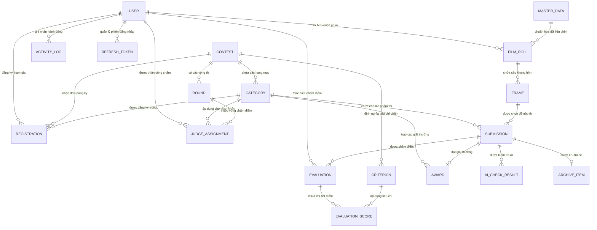

# ERD.MD - ĐẶC TẢ THỰC THỂ & MỐI QUAN HỆ CƠ SỞ DỮ LIỆU
**Dự án:** Nền tảng quản lý cuộc thi nhiếp ảnh phim tích hợp AI (Film Photography Contest Management Platform)  
**Tài liệu đầu vào (Input):** Ánh xạ thiết kế vào kiến trúc mã nguồn Backend (Flask Clean Architecture & SQLAlchemy ORM)  
**Hệ quản trị CSDL hỗ trợ:** PostgreSQL, MySQL, MS SQL Server  

---

## 1. SƠ ĐỒ MỐI QUAN HỆ THỰC THỂ (MERMAID ERD)

---

## 2. CHI TIẾT 18 THỰC THỂ VÀ THUỘC TÍNH DỮ LIỆU

### 2.1. Thực thể `users` (Tài khoản người dùng & Phân quyền RBAC)
- **Mục đích:** Lưu trữ thông tin tài khoản cho 4 vai trò: `administrator`, `organizer`, `judge`, `participant`.
- **Bảng CSDL:** `users`

| Tên thuộc tính | Kiểu dữ liệu | Ràng buộc | Giá trị mặc định | Mô tả chi tiết |
| --- | --- | --- | --- | --- |
| `id` | Integer | PK, Auto Increment | Nextval | Khóa chính |
| `email` | String(255) | Unique, Not Null | | Địa chỉ email đăng nhập |
| `password_hash` | String(255) | Not Null | | Mật khẩu băm an toàn bằng BCrypt |
| `full_name` | String(150) | Not Null | | Họ và tên người dùng |
| `role` | String(50) | Not Null | 'participant' | Vai trò: `administrator`, `organizer`, `judge`, `participant` |
| `phone` | String(20) | Nullable | NULL | Số điện thoại liên hệ |
| `bio` | Text | Nullable | NULL | Giới thiệu cá nhân |
| `status` | String(50) | Not Null | 'active' | Trạng thái: `active`, `inactive`, `suspended` |
| `created_at` | DateTime | Not Null | CURRENT_TIMESTAMP | Thời gian tạo tài khoản |
| `updated_at` | DateTime | Not Null | CURRENT_TIMESTAMP | Thời gian cập nhật gần nhất |

---

### 2.2. Thực thể `contests` (Cuộc thi nhiếp ảnh phim)
- **Mục đích:** Quản lý thông tin cuộc thi, chủ đề, vòng đời trạng thái và cơ chế khóa cấu hình.
- **Bảng CSDL:** `contests`

| Tên thuộc tính | Kiểu dữ liệu | Ràng buộc | Giá trị mặc định | Mô tả chi tiết |
| --- | --- | --- | --- | --- |
| `id` | Integer | PK, Auto Increment | Nextval | Khóa chính |
| `title` | String(255) | Not Null | | Tiêu đề cuộc thi |
| `theme` | String(255) | Not Null | | Chủ đề cuộc thi |
| `description` | Text | Nullable | NULL | Mô tả chi tiết thể lệ cuộc thi |
| `regulations` | Text | Nullable | NULL | Quy định kỹ thuật và bản quyền |
| `submission_start`| DateTime | Not Null | | Thời gian mở nhận bài nộp |
| `submission_end` | DateTime | Not Null | | Thời gian đóng nhận bài nộp |
| `judging_start` | DateTime | Not Null | | Thời gian bắt đầu chấm thi |
| `judging_end` | DateTime | Not Null | | Thời gian kết thúc chấm thi |
| `status` | String(50) | Not Null | 'draft' | Trạng thái: `draft`, `open`, `closed`, `judging`, `published`, `archived` |
| `config_locked` | Boolean | Not Null | False | Khóa cấu hình sau khi cuộc thi mở (`open`) |
| `created_by` | Integer | FK -> users.id | | Người tạo cuộc thi (Organizer) |
| `created_at` | DateTime | Not Null | CURRENT_TIMESTAMP | Ngày tạo |
| `updated_at` | DateTime | Not Null | CURRENT_TIMESTAMP | Ngày cập nhật |

---

### 2.3. Thực thể `categories` (Hạng mục thi)
- **Mục đích:** Các thể loại thi trong cuộc thi (Ảnh Đen Trắng, Ảnh Màu, Đường phố,...).
- **Bảng CSDL:** `categories`

| Tên thuộc tính | Kiểu dữ liệu | Ràng buộc | Giá trị mặc định | Mô tả chi tiết |
| --- | --- | --- | --- | --- |
| `id` | Integer | PK, Auto Increment | Nextval | Khóa chính |
| `contest_id` | Integer | FK -> contests.id, Not Null | | Cuộc thi sở hữu hạng mục |
| `name` | String(150) | Not Null | | Tên hạng mục (ví dụ: Ảnh Đen Trắng) |
| `max_photos_per_participant` | Integer | Not Null | 5 | Giới hạn số lượng bài nộp tối đa |
| `submission_rules` | Text | Nullable | NULL | Quy định riêng của hạng mục |
| `award_structure` | Text | Nullable | NULL | Cơ cấu giải thưởng dự kiến |
| `created_at` | DateTime | Not Null | CURRENT_TIMESTAMP | Ngày tạo |

---

### 2.4. Thực thể `criteria` (Tiêu chí chấm điểm)
- **Mục đích:** Định nghĩa tiêu chí đánh giá cho Giám khảo với trọng số $\le 100\%$.
- **Bảng CSDL:** `criteria`

| Tên thuộc tính | Kiểu dữ liệu | Ràng buộc | Giá trị mặc định | Mô tả chi tiết |
| --- | --- | --- | --- | --- |
| `id` | Integer | PK, Auto Increment | Nextval | Khóa chính |
| `contest_id` | Integer | FK -> contests.id, Not Null | | Cuộc thi áp dụng tiêu chí |
| `category_id` | Integer | FK -> categories.id, Nullable | NULL | Hạng mục áp dụng (NULL: áp dụng toàn cuộc thi) |
| `name` | String(150) | Not Null | | Tên tiêu chí (Kỹ thuật phơi sáng, Bố cục...) |
| `description` | Text | Nullable | NULL | Hướng dẫn chấm tiêu chí |
| `weight` | Numeric(5,2) | Not Null | | Trọng số phần trăm (%) |
| `max_score` | Numeric(5,2) | Not Null | 10.00 | Điểm tối đa của tiêu chí |
| `created_at` | DateTime | Not Null | CURRENT_TIMESTAMP | Ngày tạo |

---

### 2.5. Thực thể `rounds` (Vòng thi)
- **Mục đích:** Chia giai đoạn chấm thi thành nhiều vòng (Vòng sơ khảo, Vòng chung khảo).
- **Bảng CSDL:** `rounds`

| Tên thuộc tính | Kiểu dữ liệu | Ràng buộc | Giá trị mặc định | Mô tả chi tiết |
| --- | --- | --- | --- | --- |
| `id` | Integer | PK, Auto Increment | Nextval | Khóa chính |
| `contest_id` | Integer | FK -> contests.id, Not Null | | Cuộc thi sở hữu vòng |
| `name` | String(100) | Not Null | | Tên vòng thi (Sơ khảo, Chung kết) |
| `sequence` | Integer | Not Null | 1 | Thứ tự vòng thi |
| `status` | String(50) | Not Null | 'pending' | Trạng thái: `pending`, `active`, `completed` |
| `created_at` | DateTime | Not Null | CURRENT_TIMESTAMP | Ngày tạo |

---

### 2.6. Thực thể `registrations` (Đăng ký tham gia cuộc thi)
- **Mục đích:** Thí sinh đăng ký tham gia một hạng mục của cuộc thi, Ban tổ chức duyệt hồ sơ.
- **Bảng CSDL:** `registrations`

| Tên thuộc tính | Kiểu dữ liệu | Ràng buộc | Giá trị mặc định | Mô tả chi tiết |
| --- | --- | --- | --- | --- |
| `id` | Integer | PK, Auto Increment | Nextval | Khóa chính |
| `participant_id`| Integer | FK -> users.id, Not Null | | Thí sinh đăng ký |
| `contest_id` | Integer | FK -> contests.id, Not Null | | Cuộc thi đăng ký |
| `category_id` | Integer | FK -> categories.id, Not Null | | Hạng mục đăng ký |
| `status` | String(50) | Not Null | 'pending' | Trạng thái duyệt: `pending`, `approved`, `rejected` |
| `reason` | Text | Nullable | NULL | Ghi chú / lý do từ chối đơn của Organizer |
| `created_at` | DateTime | Not Null | CURRENT_TIMESTAMP | Ngày nộp đơn đăng ký |

---

### 2.7. Thực thể `master_data` (Dữ liệu danh mục chuẩn hóa)
- **Mục đích:** Danh mục hãng phim, dòng phim, ISO, định dạng, máy ảnh, lens, lab tráng, scanner.
- **Bảng CSDL:** `master_data`

| Tên thuộc tính | Kiểu dữ liệu | Ràng buộc | Giá trị mặc định | Mô tả chi tiết |
| --- | --- | --- | --- | --- |
| `id` | Integer | PK, Auto Increment | Nextval | Khóa chính |
| `type` | String(50) | Not Null | | Loại: `film_brand`, `film_stock`, `iso`, `film_format`, `camera`, `lens`, `lab`, `scanner` |
| `value` | String(255) | Not Null | | Tên giá trị chuẩn hóa (Kodak, Leica M3...) |
| `description` | Text | Nullable | NULL | Mô tả xuất xứ hoặc thông số kỹ thuật |
| `status` | String(50) | Not Null | 'active' | Trạng thái: `active`, `inactive` |
| `created_at` | DateTime | Not Null | CURRENT_TIMESTAMP | Ngày tạo |

---

### 2.8. Thực thể `film_rolls` (Cuộn phim của thí sinh)
- **Mục đích:** Quản lý cuộn phim vật lý làm bằng chứng nguồn gốc ảnh phim nguyên bản.
- **Bảng CSDL:** `film_rolls`

| Tên thuộc tính | Kiểu dữ liệu | Ràng buộc | Giá trị mặc định | Mô tả chi tiết |
| --- | --- | --- | --- | --- |
| `id` | Integer | PK, Auto Increment | Nextval | Khóa chính |
| `participant_id`| Integer | FK -> users.id, Not Null | | Thí sinh sở hữu |
| `film_brand_id` | Integer | FK -> master_data.id | | Hãng sản xuất phim (Kodak, Fuji...) |
| `film_stock_id` | Integer | FK -> master_data.id | | Dòng phim (Tri-X 400, Portra 160...) |
| `iso_id` | Integer | FK -> master_data.id | | Độ nhạy sáng ISO thực tế chụp |
| `film_format_id`| Integer | FK -> master_data.id | | Khổ phim (135/35mm, 120 Medium...) |
| `camera_id` | Integer | FK -> master_data.id | | Thân máy ảnh sử dụng |
| `lens_id` | Integer | FK -> master_data.id | | Ống kính sử dụng |
| `lab_id` | Integer | FK -> master_data.id | | Lab tráng phim |
| `scanner_id` | Integer | FK -> master_data.id | | Máy quét scan film |
| `scan_specs` | Text | Nullable | NULL | Ghi chú thông số file scan của Lab |
| `created_at` | DateTime | Not Null | CURRENT_TIMESTAMP | Ngày khai báo cuộn phim |

---

### 2.9. Thực thể `frames` (Khung hình trong cuộn phim)
- **Mục đích:** Từng ô khung hình cụ thể trong cuộn phim (Frame 00 đến 36).
- **Bảng CSDL:** `frames`

| Tên thuộc tính | Kiểu dữ liệu | Ràng buộc | Giá trị mặc định | Mô tả chi tiết |
| --- | --- | --- | --- | --- |
| `id` | Integer | PK, Auto Increment | Nextval | Khóa chính |
| `film_roll_id` | Integer | FK -> film_rolls.id, Not Null | | Cuộn phim sở hữu |
| `frame_number` | Integer | Not Null | | Số thứ tự frame (0-38) |
| `shooting_location` | String(255) | Nullable | NULL | Địa điểm chụp ảnh |
| `created_at` | DateTime | Not Null | CURRENT_TIMESTAMP | Ngày tạo |

---

### 2.10. Thực thể `submissions` (Bài thi dự thi)
- **Mục đích:** Tác phẩm ảnh dự thi của thí sinh gắn với khung hình đối chứng và hạng mục thi.
- **Bảng CSDL:** `submissions`

| Tên thuộc tính | Kiểu dữ liệu | Ràng buộc | Giá trị mặc định | Mô tả chi tiết |
| --- | --- | --- | --- | --- |
| `id` | Integer | PK, Auto Increment | Nextval | Khóa chính |
| `frame_id` | Integer | FK -> frames.id, Not Null | | Khung hình đối chứng gốc |
| `category_id` | Integer | FK -> categories.id, Not Null | | Hạng mục dự thi |
| `participant_id`| Integer | FK -> users.id, Not Null | | Thí sinh nộp bài |
| `title` | String(255) | Not Null | | Tiêu đề tác phẩm ảnh |
| `description` | Text | Nullable | NULL | Lời bình / câu chuyện tác phẩm |
| `image_path` | String(500) | Not Null | | Đường dẫn lưu trữ ảnh scan độ phân giải cao |
| `thumbnail_path`| String(500) | Nullable | NULL | Ảnh thu nhỏ xem trước |
| `negative_ref_path` | String(500) | Nullable | NULL | Ảnh chụp dải phim âm bản đối chứng |
| `status` | String(50) | Not Null | 'submitted' | Trạng thái: `submitted`, `under_verification`, `accepted`, `rejected`, `withdrawn` |
| `keywords` | String(500) | Nullable | NULL | Từ khóa mô tả tác phẩm |
| `submitted_at` | DateTime | Not Null | CURRENT_TIMESTAMP | Thời gian nộp bài |

---

### 2.11. Thực thể `ai_check_results` (Kết quả kiểm tra AI)
- **Mục đích:** Lưu trữ kết quả AI phát hiện ảnh trùng lặp hoặc nghi vấn ảnh AI tạo.
- **Bảng CSDL:** `ai_check_results`

| Tên thuộc tính | Kiểu dữ liệu | Ràng buộc | Giá trị mặc định | Mô tả chi tiết |
| --- | --- | --- | --- | --- |
| `id` | Integer | PK, Auto Increment | Nextval | Khóa chính |
| `submission_id` | Integer | FK -> submissions.id, Not Null| | Bài thi được kiểm tra |
| `type` | String(50) | Not Null | | Phân loại: `duplicate` (trùng lặp), `ai_generated` (ảnh AI) |
| `score` | Numeric(5,4) | Not Null | | Điểm tương đồng / xác suất nghi vấn |
| `matched_submission_id` | Integer | FK -> submissions.id, Nullable | NULL | Bài thi trùng khớp (nếu có) |
| `decision` | String(50) | Not Null | 'pending' | Quyết định: `pending`, `flagged`, `cleared` |
| `checked_at` | DateTime | Not Null | CURRENT_TIMESTAMP | Thời gian chạy kiểm tra AI |

---

### 2.12. Thực thể `judge_assignments` (Phân công Giám khảo)
- **Mục đích:** Giao nhiệm vụ cho giám khảo chấm điểm theo từng hạng mục và vòng thi.
- **Bảng CSDL:** `judge_assignments`

| Tên thuộc tính | Kiểu dữ liệu | Ràng buộc | Giá trị mặc định | Mô tả chi tiết |
| --- | --- | --- | --- | --- |
| `id` | Integer | PK, Auto Increment | Nextval | Khóa chính |
| `judge_id` | Integer | FK -> users.id, Not Null | | Giám khảo được phân công |
| `category_id` | Integer | FK -> categories.id, Not Null | | Hạng mục chấm thi |
| `round_id` | Integer | FK -> rounds.id, Nullable | NULL | Vòng thi áp dụng |
| `created_at` | DateTime | Not Null | CURRENT_TIMESTAMP | Ngày phân công |

---

### 2.13. Thực thể `evaluations` (Phiếu đánh giá của Giám khảo)
- **Mục đích:** Bảng tổng hợp nhận xét và trạng thái khóa điểm của một giám khảo cho một bài thi.
- **Bảng CSDL:** `evaluations`

| Tên thuộc tính | Kiểu dữ liệu | Ràng buộc | Giá trị mặc định | Mô tả chi tiết |
| --- | --- | --- | --- | --- |
| `id` | Integer | PK, Auto Increment | Nextval | Khóa chính |
| `judge_id` | Integer | FK -> users.id, Not Null | | Giám khảo chấm |
| `submission_id` | Integer | FK -> submissions.id, Not Null| | Bài thi được chấm |
| `comment` | Text | Nullable | NULL | Nhận xét chuyên môn của Giám khảo |
| `confirmed` | Boolean | Not Null | False | Trạng thái xác nhận (Đã xác nhận thì khóa sửa điểm) |
| `created_at` | DateTime | Not Null | CURRENT_TIMESTAMP | Ngày lập phiếu |
| `updated_at` | DateTime | Not Null | CURRENT_TIMESTAMP | Ngày cập nhật |

---

### 2.14. Thực thể `evaluation_scores` (Chi tiết điểm theo tiêu chí)
- **Mục đích:** Điểm số chi tiết cho từng tiêu chí của bài thi trong phiếu đánh giá.
- **Bảng CSDL:** `evaluation_scores`

| Tên thuộc tính | Kiểu dữ liệu | Ràng buộc | Giá trị mặc định | Mô tả chi tiết |
| --- | --- | --- | --- | --- |
| `id` | Integer | PK, Auto Increment | Nextval | Khóa chính |
| `evaluation_id` | Integer | FK -> evaluations.id, Not Null | | Phiếu đánh giá cha |
| `criterion_id` | Integer | FK -> criteria.id, Not Null | | Tiêu chí chấm điểm |
| `score` | Numeric(5,2) | Not Null | | Điểm số đạt được ($\le$ max_score) |

---

### 2.15. Thực thể `awards` (Giải thưởng cuộc thi)
- **Mục đích:** Ghi nhận các giải thưởng chính thức được trao cho tác phẩm dự thi.
- **Bảng CSDL:** `awards`

| Tên thuộc tính | Kiểu dữ liệu | Ràng buộc | Giá trị mặc định | Mô tả chi tiết |
| --- | --- | --- | --- | --- |
| `id` | Integer | PK, Auto Increment | Nextval | Khóa chính |
| `category_id` | Integer | FK -> categories.id, Not Null | | Hạng mục trao giải |
| `submission_id` | Integer | FK -> submissions.id, Not Null| | Tác phẩm đạt giải |
| `title` | String(150) | Not Null | | Tên giải (Giải Nhất, Giải Nhì, Best of Contest...) |
| `rank` | Integer | Not Null | | Thứ hạng đạt giải (1, 2, 3...) |
| `prize_amount` | String(100) | Nullable | NULL | Trị giá phần thưởng |
| `created_at` | DateTime | Not Null | CURRENT_TIMESTAMP | Ngày ghi nhận giải |

---

### 2.16. Thực thể `archive_items` (Lưu trữ triển lãm số)
- **Mục đích:** Lưu trữ vĩnh viễn các tác phẩm xuất sắc sau khi cuộc thi kết thúc phục vụ tra cứu.
- **Bảng CSDL:** `archive_items`

| Tên thuộc tính | Kiểu dữ liệu | Ràng buộc | Giá trị mặc định | Mô tả chi tiết |
| --- | --- | --- | --- | --- |
| `id` | Integer | PK, Auto Increment | Nextval | Khóa chính |
| `submission_id` | Integer | FK -> submissions.id, Not Null| | Tác phẩm được lưu trữ |
| `metadata_snapshot` | JSON / JSONB | Not Null | | Bản chụp thông số kỹ thuật máy, phim, lab, điểm số |
| `judging_comments` | Text | Nullable | NULL | Tổng hợp nhận xét của ban giám khảo |
| `archived_at` | DateTime | Not Null | CURRENT_TIMESTAMP | Ngày đưa vào lưu trữ triển lãm |

---

### 2.17. Thực thể `activity_logs` (Nhật ký kiểm toán hệ thống - Audit Logs)
- **Mục đích:** Ghi nhận mọi thao tác quan trọng để đảm bảo tính minh bạch theo chuẩn NFR-7.
- **Bảng CSDL:** `activity_logs`

| Tên thuộc tính | Kiểu dữ liệu | Ràng buộc | Giá trị mặc định | Mô tả chi tiết |
| --- | --- | --- | --- | --- |
| `id` | Integer | PK, Auto Increment | Nextval | Khóa chính |
| `user_id` | Integer | FK -> users.id, Nullable | NULL | Người thực hiện thao tác |
| `action` | String(100) | Not Null | | Hành động (CREATE_CONTEST, REVIEW_REGISTRATION...) |
| `entity_type` | String(50) | Not Null | | Tên bảng bị tác động (CONTEST, SUBMISSION, USER...) |
| `entity_id` | Integer | Nullable | NULL | ID của bản ghi bị tác động |
| `details` | JSON / JSONB | Nullable | NULL | Chi tiết thay đổi dữ liệu |
| `created_at` | DateTime | Not Null | CURRENT_TIMESTAMP | Thời điểm thực hiện |

---

### 2.18. Thực thể `refresh_tokens` (Quản lý phiên đăng nhập JWT)
- **Mục đích:** Hỗ trợ cơ chế làm mới token an toàn (Refresh Token Rotation).
- **Bảng CSDL:** `refresh_tokens`

| Tên thuộc tính | Kiểu dữ liệu | Ràng buộc | Giá trị mặc định | Mô tả chi tiết |
| --- | --- | --- | --- | --- |
| `id` | Integer | PK, Auto Increment | Nextval | Khóa chính |
| `user_id` | Integer | FK -> users.id, Not Null | | Người dùng sở hữu token |
| `token` | Text | Not Null, Unique | | Chuỗi Refresh Token JWT |
| `expires_at` | DateTime | Not Null | | Thời hạn hết hiệu lực token |
| `created_at` | DateTime | Not Null | CURRENT_TIMESTAMP | Thời điểm cấp token |

---

## 3. RÀNG BUỘC TOÀN VẸN VÀ LOGIC NGHIỆP VỤ (INTEGRITY CONSTRAINTS)

1. **Khóa duy nhất định danh:**
   - `users(email)`: Một địa chỉ email chỉ đăng ký một tài khoản duy nhất.
   - `registrations(participant_id, contest_id, category_id)`: Một thí sinh chỉ được nộp một đơn đăng ký cho một hạng mục trong cùng một cuộc thi.
   - `frames(film_roll_id, frame_number)`: Mỗi khung hình đánh số là duy nhất trong một cuộn phim.
   - `evaluations(judge_id, submission_id)`: Mỗi giám khảo chỉ chấm một bài thi duy nhất một lần.
   - `evaluation_scores(evaluation_id, criterion_id)`: Mỗi tiêu chí trong một phiếu đánh giá chỉ có một điểm số.

2. **Khóa cấu hình cuộc thi (Config Locking):**
   - Khi `contests.status` chuyển từ `draft` sang `open`, cờ `config_locked = true` được kích hoạt. Không cho phép sửa đổi tiêu chí chấm, trọng số hoặc thời gian nộp bài nữa.

3. **Tính toán trọng số tiêu chí (Criteria Weight Sum):**
   - Tổng trọng số $\sum \text{weight}$ của các tiêu chí trong một cuộc thi phải bằng đúng $100.0\%$.

4. **Khóa sửa điểm đánh giá (Evaluation Confirmation):**
   - Khi giám khảo chọn xác nhận nộp bảng điểm (`evaluations.confirmed = true`), hệ thống khóa quyền chỉnh sửa điểm số để đảm bảo tính công tâm tuyệt đối.
