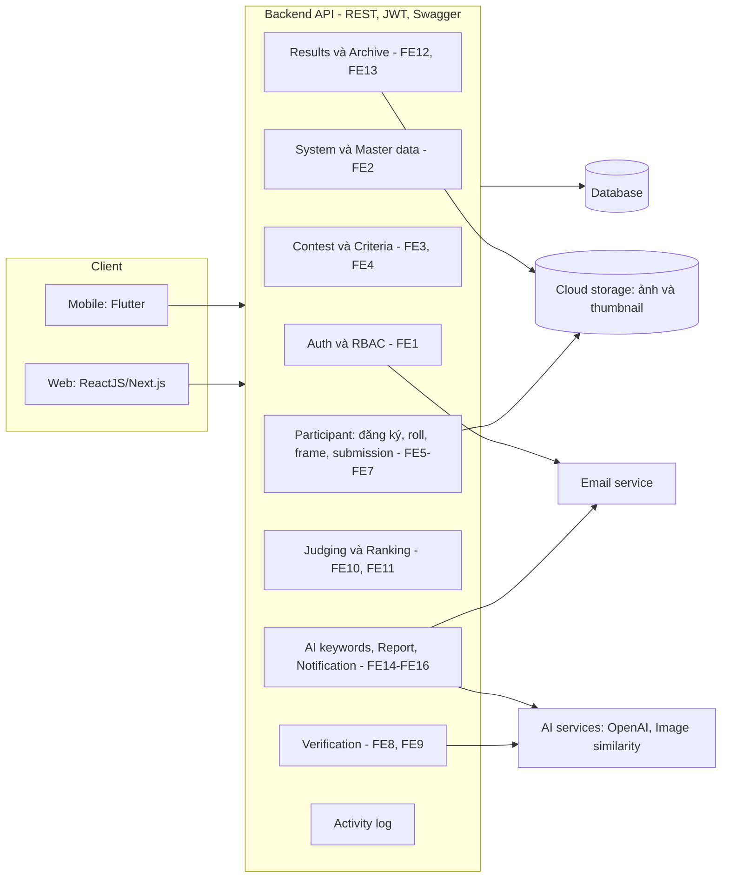
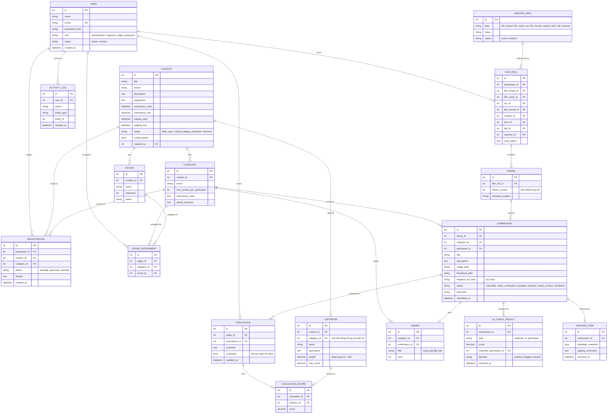

# Kiến trúc hệ thống và thiết kế cơ sở dữ liệu (bản nháp Sprint 1)

Phục vụ các story CNPM-28 (kiến trúc modular và chốt công nghệ) và CNPM-29 (ERD và database schema). Đây là bản nháp để nhóm duyệt trong buổi họp tối 3/11/2026. Nội dung bám theo [05-srs.md](05-srs.md) mục 5.1 và NFR-1 đến NFR-10. Mermaid hiển thị trực tiếp trên GitHub.

## 1. Quyết định công nghệ (ghi lại sau buổi họp)

| Hạng mục | Đề xuất mặc định | Trạng thái |
| --- | --- | --- |
| Backend | Node.js (Express + TypeScript), REST API, Swagger | Đã chốt & triển khai |
| Cơ sở dữ liệu | PostgreSQL 16 | Đã chốt & thiết kế DDL 18 bảng |
| Lưu ảnh | Firebase Storage / Cloud Storage, riêng tư, URL ký thời hạn | Chờ cấu hình bucket |
| Web | ReactJS / Next.js | Theo kế hoạch |
| Mobile | Flutter (mức Should) | Theo kế hoạch |
| AI | OpenAI API và dịch vụ Computer Vision / so sánh ảnh | Theo kế hoạch |
| Xác thực | JWT (Access & Refresh Token) và RBAC (4 vai trò) | Đã hoàn thành |

Thiết kế dưới đây độc lập với ngôn ngữ backend và hệ quản trị cơ sở dữ liệu, nên không phải làm lại nếu nhóm chọn ASP.NET Core hoặc MySQL.

## 2. Kiến trúc modular (NFR-3)



Quy tắc của kiến trúc:

- Mỗi module (thư mục riêng trong `BE/`) sở hữu bảng dữ liệu của mình và chỉ gọi module khác qua service/interface, không truy cập thẳng vào bảng của nhau.
- Middleware xác thực JWT và kiểm tra vai trò áp dụng cho mọi endpoint (FR-1.5).
- Dịch vụ AI và lưu trữ được bọc sau một lớp adapter. Khi dịch vụ lỗi, hệ thống ghi lỗi, đánh dấu "AI check pending" và chuyển sang duyệt tay (NFR-6).
- Ảnh luôn riêng tư; chỉ trả URL ký có thời hạn. Chỉ công khai sau khi cuộc thi chuyển sang published (NFR-2).
- Bản ghi đánh giá đã xác nhận và kết quả đã công bố không sửa được (NFR-7).

Cấu trúc thư mục gợi ý cho `BE/`:

```
BE/
├── src/
│   ├── modules/
│   │   ├── auth/            # FE1
│   │   ├── system/          # FE2: cấu hình, master data
│   │   ├── contest/         # FE3, FE4
│   │   ├── participant/     # FE5, FE6, FE7
│   │   ├── verification/    # FE8, FE9
│   │   ├── judging/         # FE10, FE11
│   │   ├── publication/     # FE12, FE13
│   │   └── support/         # FE14, FE15, FE16
│   ├── common/              # middleware JWT/RBAC, error, logger, adapter storage/AI
│   └── config/
├── tests/
└── README.md
```

## 3. ERD



### Ràng buộc quan trọng

| Ràng buộc | Lý do (nguồn) |
| --- | --- |
| `USER.email` duy nhất; mật khẩu chỉ lưu dạng băm | FR-1.1, NFR-1 |
| `REGISTRATION` duy nhất theo (participant, contest, category); không đăng ký sau hạn | FR-5.3 |
| `FRAME` duy nhất theo (film_roll, frame_number) | FR-6.2 |
| Không xóa `FILM_ROLL`/`FRAME` đã gắn `SUBMISSION` | FR-6.3 |
| Số `SUBMISSION` của một participant trong một category không vượt `max_photos_per_participant` | FR-7.3 |
| Tổng `CRITERION.weight` của một cuộc thi hoặc hạng mục bằng 100; khóa khi bắt đầu chấm | FR-4.1, FR-4.3 |
| `EVALUATION` duy nhất theo (judge, submission); sau khi `confirmed` thì không sửa | FR-10.5, NFR-7 |
| `EVALUATION_SCORE` duy nhất theo (evaluation, criterion), điểm không vượt `max_score` | FR-10.3 |
| `MASTER_DATA` đang được dùng thì chỉ chuyển `inactive`, không xóa | FR-2.2 |
| Chỉ submission `accepted` mới được giao cho giám khảo | FR-8.3 |
| Ảnh riêng tư cho đến khi `CONTEST.status = published` | NFR-2 |

## 4. Trạng thái chính

Cuộc thi: `draft → open → closed → judging → published → archived` (chỉ nhận bài khi `open`).

Bài nộp: `submitted → under_verification → accepted | rejected | needs_revision`; thí sinh có thể `withdrawn` trước hạn.

## 5. Việc tiếp theo cho CNPM-28 và CNPM-29

- [ ] Nhóm duyệt bản nháp, chốt công nghệ ở mục 1, cập nhật cột "Trạng thái".
- [ ] Sinh migration/schema đầu tiên cho các bảng `USER`, `MASTER_DATA` (FE1, FE2 ở Sprint 1); các bảng còn lại làm theo từng sprint.
- [ ] Dựng skeleton `BE/` theo cấu trúc thư mục ở mục 2 và đẩy lên nhánh `CNPM-32-...`.
- [ ] Đính kèm ảnh xuất ERD và liên kết tài liệu này vào story CNPM-28, CNPM-29 trên Jira.
